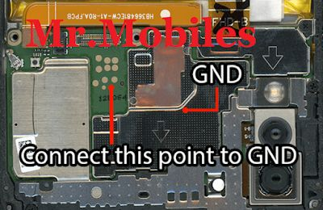

# FRP Unlock Guide — Huawei P20 Lite (ANE-LX1)

Tested on ANE-LX1 C432, EMUI 9.1.0.401 (C432E13R1P7), Kirin 659, Windows 11.

## Tools Needed

| Tool | Purpose | Location |
|------|---------|----------|
| **PotatoNV-next v2.2.1** | Bootloader unlock via VCOM | Included in `tools/` as zip. Extract before use. |
| **Android Platform Tools** | fastboot commands | Download from [Google](https://developer.android.com/tools/releases/platform-tools), extract to `tools/`. |

## Physical Tools

- Small Phillips screwdriver
- Plastic pry tool / guitar pick
- Metal tweezers (non-coated tips)
- USB-A to USB-C/Micro-USB cable

## Overview

1. Open phone, short test point to enter VCOM mode
2. PotatoNV uploads temporary bootloader and unlocks FBLOCK
3. Phone enters fastboot with unlocked bootloader
4. Erase FRP partition via fastboot
5. Reboot — FRP gone

## Step-by-Step

### 1. Prepare Windows Drivers

The VCOM device must appear as a COM port. If it shows as "USB SER" under "Other devices" in Device Manager:

1. Right-click USB SER > **Update driver**
2. **Browse my computer** > **Let me pick from a list**
3. Select **USB Serial Device** (Microsoft)

If it gets grabbed by libusb-win32 or the unsigned Huawei driver (Code 39), remove those drivers first:

```
pnputil /enum-drivers | findstr /i "libusb hw_usbvcom"
pnputil /delete-driver oem##.inf /force
pnputil /remove-device "USB\VID_12D1&PID_3609\..."
```

Replace `oem##` and device instance ID with actual values from your system.

### 2. Open the Phone

1. Remove SIM tray
2. Heat the back cover edges with a hair dryer (~60 seconds)
3. Insert plastic pry tool at the bottom edge, slide around to release adhesive
4. Lift back cover carefully

### 3. Locate the Test Point

See `assets/testpoint-ane-lx1.jpg`:



The test point is a small pad near the CPU. Short it to the metal shielding (GND) with tweezers.

### 4. Prepare PotatoNV

1. Launch `PotatoNV-next.exe` **from its own directory** (bootloader dropdown won't populate otherwise)
2. Set **Bootloader** to `hisi65x_a (Kirin 65x A)`
3. Check **"Disable FBLOCK (Not recommended)"**

### 5. Enter VCOM Mode

1. Phone must be **fully powered off** (hold power 15 sec to force off)
2. USB cable **unplugged**
3. Touch tweezers to the test point pad, shorting it to GND
4. While holding the short, **plug in the USB cable** — do NOT press power button
5. Wait for USB chime on PC
6. A COM port should appear in Device Manager under Ports (e.g., COM10)

**VCOM lasts ~10-30 seconds.** Be fast.

### 6. Run PotatoNV

1. Select the COM port in PotatoNV's Target Device dropdown
2. Click **Start** immediately
3. PotatoNV will upload xloader + fastboot and unlock the bootloader
4. Output should show `FBLOCK state: UNLOCKED`
5. The phone will enter fastboot mode (black screen is normal)

### 7. Erase FRP via Fastboot

Verify the phone is in fastboot and bootloader is unlocked:

```
fastboot devices
fastboot oem get-bootinfo
```

Should show `unlocked`. Then:

```
fastboot erase frp
fastboot reboot
```

### 8. Done

The phone boots without FRP. Go through setup and skip or use any Google account.

### 9. Reassemble

1. Clean old adhesive from back cover edges
2. Apply thin double-sided tape or B-7000 glue
3. Press back cover firmly, start from top
4. Reinsert SIM tray

## Troubleshooting

| Problem | Fix |
|---------|-----|
| USB SER shows under libusb-win32 | Delete the libusb OEM driver with `pnputil`, remove ghost device, retry |
| HUAWEI USB COM 1.0 — Code 39 | Driver is unsigned, won't load on Win11. Delete it, use Microsoft USB Serial Device instead |
| PotatoNV bootloader dropdown empty | Launch from its own directory, not from a shortcut |
| "Port COM## does not exist" | Wrong COM port selected, or VCOM timed out. Redo test point |
| "A device attached to the system is not functioning" | VCOM dropped during upload. Redo test point, be faster. Keep tweezers held |
| `fastboot erase frp` → "Command not allowed" | Bootloader still locked. Redo VCOM + PotatoNV with "Disable FBLOCK" checked |
| Phone boots normally instead of VCOM | Don't press power button. Only short test point + plug USB |

## Key Learnings

- The Microsoft **USB Serial Device** driver (`usbser.sys`) works. The old Huawei `hw_usbvcom.sys` does not on Windows 11.
- Zadig's libusb-win32 makes the device visible but **not as a COM port** — PotatoNV needs a COM port.
- After removing bad drivers, also remove the ghost device with `pnputil /remove-device` so Windows picks the correct driver on next plug.
- **"Disable FBLOCK"** checkbox in PotatoNV was required for the unlock to actually take effect.
- VCOM window is very short (~10-30 sec). Have everything prepared before shorting.
